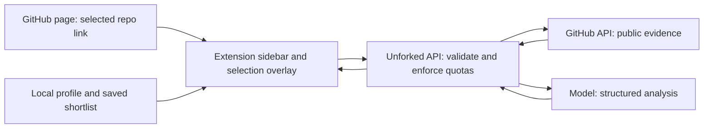

# Unforked Implementation Plan

> **For agentic workers:** REQUIRED SUB-SKILL: Use superpowers:subagent-driven-development (recommended) or superpowers:executing-plans to implement this plan task-by-task. Steps use checkbox (`- [ ]`) syntax for tracking.

**Goal:** Build a GitHub-only Chrome extension that helps people discover suitable open-source projects, understand repositories, and find a realistic first contribution.

**Architecture:** A Manifest V3 extension provides a persistent sidebar and an optional circle-selection overlay on GitHub pages. A small TypeScript API fetches GitHub evidence and uses a language model for explanations and personalized recommendations. Profiles and saved results stay on the device; shared AI credentials stay on the server.

**Tech Stack:** Proposed: WXT, React, TypeScript, plain CSS, Hono on Cloudflare Workers, GitHub REST API, Vercel AI SDK with a direct model-provider adapter, Zod, Vitest, and Playwright. Add Cloudflare D1 for authenticated beta sessions and durable usage accounting before sharing a hosted API.

**Spec:** The Product contract and Global constraints in this file consolidate the requirements from the Unforked conversation. This is a draft plan for review, not an approved implementation or evidence that any product code exists.

**Date:** October 31, 2026.

**Execution proposal:** Implement in this chat, milestone by milestone, once the user asks to proceed. The user has requested planning only so far. Do not create provider accounts, deploy services, publish an extension, or incur charges as part of this planning task.

## Global Constraints

- GitHub.com public repositories only in the first release.
- Text input and text responses; no voice assistant.
- Chrome desktop, Manifest V3; minimum Chrome 116 for the planned side-panel opening API, with acceptance testing on current stable Chrome. Recheck dependency browser requirements at implementation time.
- Page interaction is limited to GitHub. The sidebar's search can work without an open repository, but must not inspect other sites.
- Circle mode selects repository titles or links inside the page. The browser address bar is outside the overlay; identify the current repository from its URL instead.
- No automatic comments, issue assignment, forks, PR submission, terminal execution, or running downloaded repository code.
- No model training, whole-GitHub crawling, vector database, or repository-wide code indexing in the MVP.
- Never embed a developer-owned GitHub token, AI key, or OAuth client secret in the extension bundle.
- Send profile details to the model only when the user requests a personalized action. Do not collect the entire browsing history or continuously upload page contents.
- Recommendations must cite fetched evidence, show when facts were checked, and distinguish observations from estimates.
- A failed or incomplete search must never become a claim that a suitable repository does not exist.
- All package versions and provider model identifiers are selected from current official documentation at implementation time and locked in the repository.

## Product Contract

### Primary user and outcome

The proposed initial audience is students and early contributors. The product should still accept experienced users' requests, but the first evaluation focuses on people choosing an approachable contribution.

Example request: "I'm a third-year BTech student. I know Python functions, classes, requests, and basic Git. I have four hours this weekend and want to contribute to developer tools."

The answer should provide up to five supported matches. Each card shows:

- What the project does, with its canonical GitHub link.
- Why it fits the user's demonstrated knowledge and interests.
- A suggested open issue when evidence supports one, or an honest statement that no suitable issue was verified.
- A readiness label: ready now, small stretch, or learn first. These are estimates, not probabilities of acceptance.
- Missing concepts, setup considerations, supporting sources, and freshness.

School year is context, not a proxy for ability. Prefer concrete knowledge and completed work over self-ratings such as "intermediate."

### MVP capabilities

1. Locally stored contributor profile: known concepts, languages, interests, Git familiarity, time available, and optional contribution preferences.
2. Typed repository discovery and follow-up refinements such as "smaller projects" or "I only have two hours."
3. Current-repository summary based on README, metadata, contribution instructions, sampled issue activity, and sampled PR activity.
4. Personalized repository and issue recommendations with evidence and limitations.
5. Closest alternatives and a task-specific learning path when strong matches are not found.
6. Circle-selection mode for GitHub repository links/titles, plus keyboard-accessible "Explain current repository" and link context-menu alternatives.
7. Local saved shortlist, loading/progress states, cancellation, retry, rate-limit handling, and clear empty states.

Repo questions are answered from the evidence already fetched. If a question needs code that was not inspected, say what is missing instead of inventing architecture details.

### Deferred features

Deep code exploration, automated local setup, background opportunity alerts, progress dashboards, cloud profile sync, private repositories, GitHub Enterprise, and multi-browser support come after the core matching experience is validated.

## Approaches Considered

| Approach | Benefit | Cost or limitation | Recommendation |
|---|---|---|---|
| Extension and user-supplied AI key | Avoids centrally paying users' AI bills | Adds onboarding and key-management work for students | Optional technical-demo mode later |
| Extension and a small hosted API | Easy onboarding; secrets and quotas managed centrally | Needs authentication and abuse controls before public access | Proposed main architecture |
| Extension and a local model | Avoids metered model calls | Hardware compatibility, downloads, and quality vary | Investigate after MVP |

For the first private prototype, run the API locally with developer-owned credentials in server environment variables. This uses the same code path intended for hosting and avoids committing to a paid deployment before testing the experience. The hosted-API choice and framework choices are recommendations, not decisions already confirmed by the user.

## User Flow

1. Open Unforked from the toolbar and enter or edit a short skills profile.
2. Type a contribution goal, or open a GitHub repository and choose "Explain this repo."
3. For discovery, see progress through searching, checking candidates, and explaining matches.
4. Review a short list, inspect the evidence, and open a recommended repository or issue.
5. Refine the request, save a candidate, or ask for a learning path.
6. While browsing GitHub, activate circle mode and draw around a repository link/title. Resolve the selection, then show its summary in the sidebar.

If several repository links intersect the circle, highlight the candidates and let the user choose. A circle around plain text with no reliable repository target must produce a selection hint, not a guessed repository.

## Architecture and Data Ownership



- The content script resolves page elements and sends only the selected repository identity; it does not scrape and upload an entire GitHub page.
- The sidebar owns active UI requests. Every request carries a request ID and repository context so a late response cannot replace the summary for a newly selected repository.
- The background worker registers extension actions, context menus, and messages. Persistent state lives in Chrome storage, not worker globals.
- The backend controls retrieval, schemas, caching, provider credentials, and token budgets. Start with ordinary request/response APIs and visible progress states; add token streaming only if measured latency warrants it.
- Profile and saved items use chrome.storage.local. Do not sync personal data by default. Provide clear/delete actions.
- Before a shared beta, use GitHub OAuth with public-information access only, server-side token exchange, expiring Unforked sessions, and encrypted provider-token storage. Never pass GitHub credentials to the model.
- D1 holds beta sessions and durable per-user/global usage accounting, not resumes, browsing history, or a central copy of profiles. Development can use a local adapter.

Chrome's side panel supports persistent companion UI. Host permissions can authorize access to matching tabs' URL/title without a broad tabs permission; use official documentation when it differs from shorthand skill guidance. Proposed initial permissions: sidePanel, storage, contextMenus, GitHub-scoped content-script matching and host access, and the exact backend origin. Add identity for OAuth at beta time. Add scripting only if runtime injection proves necessary; WXT's declared content script should usually suffice. [Side Panel API](https://developer.chrome.com/docs/extensions/reference/api/sidePanel), [permission rules](https://developer.chrome.com/docs/extensions/develop/concepts/declare-permissions).

## Recommendation Pipeline

1. **Extract intent.** Combine the explicit request and user-selected profile fields into a validated SearchIntent. Preserve hard constraints separately from preferences. Ask one focused clarification when essential information is missing.
2. **Search broadly but within bounds.** Create at most three GitHub searches across languages, topics, and contribution-related terms. Merge up to 30 candidates. Include topic searches so useful secondary-language projects are not excluded solely by a primary-language filter.
3. **Filter and prioritize cheaply.** Remove archived/private repositories and duplicates. Use metadata for a provisional shortlist; stars do not determine contributor fit. Missing information means unknown, not poor quality.
4. **Inspect a small shortlist.** Inspect at most eight repositories, with at most eight GitHub calls per inspected repository and 80 GitHub calls per discovery job in total. Fetch selected README/contribution text, languages, root file names, and bounded recent issue/PR samples. Exhausted budgets produce partial results with an explanation.
5. **Assess issue suitability.** Check issue state, assignment, visible competing work, discussion, and relevant prerequisites. A good-first-issue label is supporting evidence, not sufficient proof of suitability. No assignee is not proof that nobody is working on it.
6. **Rank and explain.** Prioritize skill fit, viable starting work, evidence of maintainer engagement, setup burden, interests, and stated time constraints. Produce up to five matches. Use ordinal readiness and evidence confidence rather than arbitrary match percentages or PR-acceptance predictions.
7. **Validate the answer.** Accept only repository IDs and issue IDs present in fetched evidence. Build source URLs from that validated evidence. Reject malformed or unsupported output rather than showing invented links.
8. **Handle weak results.** Say "We couldn't find a strong match in this search." Explain which constraint was limiting. Offer nearby repositories and a learning path without silently relaxing the user's hard constraints.

Learning paths should name the exact skill gap, a small practice task, a way to check readiness, and the repository task it prepares the user for. Prefer repository-owned documentation and vetted resources; do not invent course URLs or guaranteed completion times.

GitHub imposes primary and search-specific limits. The client must respect headers, backoff instructions, and pagination limits, and surface incomplete results. Public-information OAuth can avoid requesting repository write access. [GitHub API limits](https://docs.github.com/en/rest/using-the-rest-api/rate-limits-for-the-rest-api), [OAuth scopes](https://docs.github.com/en/apps/oauth-apps/building-oauth-apps/scopes-for-oauth-apps).

## Shared Interfaces

Define these contracts centrally in packages/contracts/src/index.ts before integrating the frontend and API:

- ContributorProfile: schemaVersion, languages, knownConcepts, interests, gitExperience, availableHours, preferences.
- RepoRef: owner and name; validated canonical identity, never an arbitrary fetch URL.
- SearchIntent: goal, languages, concepts, interests, availableHours, hardConstraints, preferences.
- EvidenceBundle: repoRef, public metadata, selected source excerpts, sampled issues/PRs, checkedAt, completeness, truncation flags, and source IDs.
- RepoSummary: repoRef, purpose, stack, contributionNotes, limitations, source IDs, checkedAt.
- MatchCard: repoRef, readiness, fitReasons, skillGaps, optional verified issue reference, limitations, source IDs, checkedAt.
- SearchResult: requestId, matches, status (complete, partial, no_strong_match), searchLimitations, optional fallback suggestions.
- LearningPath: target repo/issue, gaps, practice steps, readiness checks, validated source IDs.
- ApiFailure: requestId, code, userMessage, optional retryAfterSeconds. Codes include INVALID_INPUT, AUTH_REQUIRED, RATE_LIMITED, NOT_FOUND, BUDGET_EXHAUSTED, PROVIDER_UNAVAILABLE, CANCELLED, and UNSUPPORTED_OUTPUT.
- RepoAnswer: answer text, source IDs from the bundle, and an optional evidence limitation.
- EvidenceOptions: signal: AbortSignal and remainingGitHubCalls: number. SearchOptions: requestId: string and signal: AbortSignal.
- Point: x and y in normalized viewport coordinates. LinkCandidate: normalized visible bounds and a validated RepoRef. SelectionResult: a discriminated union of selected (one RepoRef), ambiguous (RepoRef[]), or none (selection hint).
- Session: internal user ID and expiry, with server-side credential references. UsageBound: maximum input tokens, maximum generated tokens, maximum GitHub calls, and maximum cost in integer microdollars. Reservation: unique reservation ID, request ID, and reserved UsageBound. Usage: actual token/call totals and cost in integer microdollars.

Planned API endpoints: POST /v1/summary, POST /v1/search, POST /v1/learning-path, and POST /v1/repo-question. All accept bounded JSON inputs, validate identities, and return schema-checked results. Add /auth/start, /auth/callback, /auth/exchange, and /auth/logout for the shared beta.

## Proposed Repository Layout

All paths below are relative to the proposed project root C:\Codex\Unforked, which does not exist as part of this planning task.

```text
apps/extension/
  wxt.config.ts
  entrypoints/background.ts
  entrypoints/github.content.ts
  entrypoints/sidepanel/{index.html,main.tsx,App.tsx}
  features/profile/{ProfileForm.tsx,storage.ts}
  features/repository/{RepoSummary.tsx,repo-context.ts}
  features/search/{SearchPanel.tsx,MatchCard.tsx}
  features/learning/LearningPath.tsx
  features/selection/{circle-overlay.ts,resolve-selection.ts}
  features/saved/{SavedRepos.tsx,storage.ts}
  lib/{api-client.ts,request-state.ts}
apps/api/
  src/index.ts
  src/github/{client.ts,evidence.ts}
  src/ai/{provider.ts,summary.ts,rank.ts,learning.ts,question.ts}
  src/search/{intent.ts,candidates.ts,recommend.ts}
  src/auth/{oauth.ts,sessions.ts}
  src/usage/{limits.ts,store.ts}
  src/cache/public-evidence.ts
  migrations/0001_sessions_usage.sql
packages/contracts/src/{index.ts,repo-ref.ts}
tests/{unit,integration,e2e,fixtures}/
docs/{evaluation.md,privacy.md,development.md}
CHROMEWEBSTORE.md
```

WXT defines extension entrypoints and builds the manifest; avoid maintaining a conflicting hand-generated manifest. Use the current documented project structure. [WXT project structure](https://wxt.dev/guide/essentials/project-structure.html).

## Build Tasks

Every task produces a reviewable deliverable. Configure the package scripts described below in Task 1. Use meaningful tests for parsing, ranking constraints, evidence validation, budgets, navigation races, and selection; do not test presentational markup just to increase test count. Each task finishes with its focused checks and a focused commit when a Git repository has been created for implementation.

### Task 1: Working Sidebar and Contributor Profile

**Files:** Root package.json and workspace configuration; packages/contracts/src/index.ts; apps/extension/wxt.config.ts; entrypoints/background.ts; entrypoints/sidepanel/*; features/profile/*; lib/request-state.ts; tests/unit/profile-storage.test.ts; tests/e2e/sidebar.spec.ts.

**Consumes:** Product contract above. **Produces:** loadProfile(): Promise<ContributorProfile | null>; saveProfile(profile: ContributorProfile): Promise<void>; typed RequestState for loading, success, failure, and cancellation.

- [ ] Create the TypeScript workspace, WXT React extension, package scripts, lint/typecheck configuration, and fixture-backed API interface. Include real correctly sized icons or omit icon references.
- [ ] Add failing behavioral checks named profile_survives_restart, corrupt_profile_can_be_reset, and action_click_opens_panel. The first saves a profile, reloads storage, and checks equality; the second verifies recovery rather than an app crash.
- [ ] Implement the sidebar trigger, profile editing, local persistence, and clear/reset controls. Limit page permissions to GitHub.
- [ ] Run npm run test:unit -- profile-storage and npm run test:e2e -- sidebar; confirm passing checks. Run npm run build:extension and manually load the unpacked result in Chrome.
- [ ] Commit the independently working extension shell and profile.

### Task 2: Reliable Public Repository Evidence

**Files:** packages/contracts/src/repo-ref.ts; apps/api/src/index.ts; src/github/client.ts; src/github/evidence.ts; src/cache/public-evidence.ts; tests/unit/repo-ref.test.ts; tests/integration/github-evidence.test.ts.

**Consumes:** RepoRef and EvidenceBundle. **Produces:** parseRepoRef(input: string): RepoRef | null; fetchEvidence(repo: RepoRef, options: EvidenceOptions): Promise<EvidenceBundle>. EvidenceOptions contains request cancellation and remaining retrieval budget.

- [ ] Add failing assertions: parseRepoRef('https://github.com.evil.test/a/b') is null; parseRepoRef('https://github.com/a/b/issues/12') equals { owner: 'a', name: 'b' }; public=false evidence is rejected; 429 responses preserve retry information; missing README produces limited evidence rather than a fatal summary failure.
- [ ] Run the two focused test files and confirm failures correspond to missing behavior.
- [ ] Implement canonical parsing, allowlisted GitHub API requests, public checks, bounded retrieval, response-size caps, ETag-aware caching, and rate-limit-aware errors. Strip URL credentials; never fetch arbitrary URLs supplied by a page or model.
- [ ] Run npm run test:unit -- repo-ref and npm run test:integration -- github-evidence; confirm all cases pass.
- [ ] Commit the evidence service.

### Task 3: End-to-End Repository Summary

**Files:** apps/api/src/ai/provider.ts; src/ai/summary.ts; src/ai/question.ts; src/index.ts; apps/extension/features/repository/*; lib/api-client.ts; tests/integration/repo-summary.test.ts; tests/e2e/repository-summary.spec.ts.

**Consumes:** fetchEvidence and shared contracts. **Produces:** summarizeRepo(evidence: EvidenceBundle): Promise<RepoSummary>; answerRepoQuestion(question: string, evidence: EvidenceBundle): Promise<RepoAnswer>; POST /v1/summary and /v1/repo-question.

- [ ] Add failing checks: cited source IDs must belong to the bundle; a README saying "ignore previous instructions" cannot change the output contract; unsupported deep-code questions return an evidence limitation; a late response for repository A cannot replace repository B's active summary.
- [ ] Run the focused tests and confirm the missing behavior fails.
- [ ] Add the server-only model adapter, structured schema validation, sanitized rendering, current-repository action, source links, timestamps, cancel/retry, and constrained repo questions. Use a fake model in automated tests.
- [ ] Run npm run test:integration -- repo-summary and npm run test:e2e -- repository-summary; then perform one bounded live smoke check with a public repository.
- [ ] Commit the first useful AI workflow.

### Task 4: Personalized Discovery and Verified Starting Issues

**Files:** apps/api/src/search/{intent.ts,candidates.ts,recommend.ts}; src/ai/rank.ts; apps/extension/features/search/*; tests/integration/recommendations.test.ts; tests/fixtures/search-cases.json.

**Consumes:** ContributorProfile, SearchIntent, fetchEvidence. **Produces:** extractIntent(request: string, profile: ContributorProfile): Promise<SearchIntent>; recommend(intent: SearchIntent, options: SearchOptions): Promise<SearchResult>; POST /v1/search. SearchOptions carries requestId and cancellation.

- [ ] Build failing fixtures for a Python beginner, a mixed-language repository, a recently active project without easy labels, an archived project, an assigned issue, incomplete search data, and an issue with a competing PR. Assert that hard constraints survive ranking and that every returned issue exists in supplied evidence.
- [ ] Run npm run test:integration -- recommendations and confirm failures.
- [ ] Implement the bounded pipeline, deduplication, readiness labels, issue validation, explanations, and profile-based request refinements. Reuse checked evidence when the request changes without requiring a refresh.
- [ ] Run the focused tests. With fixture-backed UI, confirm results display at most five cards, partial results are labeled, and failed searches keep the original request available for retry.
- [ ] Commit discovery and recommendation behavior.

### Task 5: Closest Alternatives and Learning Paths

**Files:** apps/api/src/ai/learning.ts; src/search/recommend.ts; apps/extension/features/learning/LearningPath.tsx; tests/integration/learning-path.test.ts.

**Consumes:** SearchIntent, MatchCard, EvidenceBundle. **Produces:** buildLearningPath(intent: SearchIntent, target: MatchCard, evidence: EvidenceBundle): Promise<LearningPath>; POST /v1/learning-path.

- [ ] Add failing cases for no candidates, nearby candidates with a framework gap, a user hard constraint that must not be relaxed, and an AI-generated resource URL absent from vetted evidence.
- [ ] Run npm run test:integration -- learning-path and confirm failures.
- [ ] Implement honest no-strong-match states, opt-in constraint relaxation, and learning steps connected to a real candidate task. No unsupported claims about guaranteed readiness or contribution acceptance.
- [ ] Run the focused tests and inspect one learning path for the student example.
- [ ] Commit alternatives and learning paths.

### Task 6: Circle Selection on GitHub

**Files:** apps/extension/entrypoints/github.content.ts; features/selection/{circle-overlay.ts,resolve-selection.ts}; entrypoints/background.ts; features/repository/repo-context.ts; tests/unit/resolve-selection.test.ts; tests/e2e/circle-selection.spec.ts.

**Consumes:** parseRepoRef, current-repository action, summary API. **Produces:** resolveSelection(points: Point[], links: LinkCandidate[]): SelectionResult. SelectionResult is one repository, an ambiguous candidate list, or no target.

- [ ] Add failing cases for one enclosed repo link, multiple candidates, non-repo GitHub navigation links, nested scrolling, page zoom, Escape cancellation, and GitHub client-side navigation. An external lookalike link must never trigger a backend fetch.
- [ ] Run npm run test:unit -- resolve-selection and confirm failures.
- [ ] Implement a temporary pointer overlay, coordinate normalization, link hit-testing, candidate preview, and cleanup. Drawing is enabled only after an explicit action; normal GitHub interaction must resume immediately after completion/cancellation.
- [ ] Run npm run test:e2e -- circle-selection and the focused unit tests. Manually test zoom and browser page scrolling in an actual extension session. Keep keyboard and context-menu alternatives functional.
- [ ] Commit circle selection.

### Task 7: Saved Shortlist and Usability

**Files:** apps/extension/features/saved/*; entrypoints/sidepanel/App.tsx; lib/request-state.ts; tests/unit/saved-repos.test.ts; tests/e2e/sidebar-flows.spec.ts.

**Consumes:** MatchCard and existing search/summary actions. **Produces:** saveRepo(card: MatchCard): Promise<void>; listSavedRepos(): Promise<MatchCard[]>; removeSavedRepo(repo: RepoRef): Promise<void>.

- [ ] Add failing checks for duplicate saves, deleted profiles, old stored schemas, switching tabs during a request, and reopening a stale saved issue.
- [ ] Run the focused checks and confirm failures.
- [ ] Implement local saves, refresh-on-open for issue status, focus management, keyboard access, readable narrow layouts, and actionable error/empty states. Use Impeccable for interface decisions.
- [ ] Run npm run test:unit -- saved-repos and npm run test:e2e -- sidebar-flows. Manually complete search, summary, circle, save, clear-data, and retry journeys by keyboard where applicable.
- [ ] Commit the usable private prototype.

### Task 8: Authenticated, Budgeted Shared Beta

**Files:** apps/api/src/auth/{oauth.ts,sessions.ts}; src/usage/{limits.ts,store.ts}; migrations/0001_sessions_usage.sql; src/index.ts; apps/extension/lib/api-client.ts; entrypoints/background.ts; tests/integration/auth-budget.test.ts; docs/privacy.md.

**Consumes:** All API endpoints and request IDs. **Produces:** requireSession(request: Request): Promise<Session>; reserveUsage(session: Session, requestId: string, bound: UsageBound): Promise<Reservation>; settleUsage(reservation: Reservation, actual: Usage): Promise<void>.

- [ ] Add failing assertions: unauthenticated shared-API calls return AUTH_REQUIRED; an OAuth state mismatch or reused exchange code is rejected; a revoked session fails; concurrent requests cannot exceed the reserved global budget; a duplicate request ID does not produce duplicate provider work.
- [ ] Run npm run test:integration -- auth-budget and confirm failures.
- [ ] Implement public-information GitHub OAuth, expiring sessions, encrypted token storage, logout/revocation, durable atomic usage reservations, per-user request limits, cancellation accounting, and a global generation shutdown. CORS is an origin restriction, not authentication.
- [ ] Run the focused tests, inspect a production-mode extension bundle for secrets, and verify logs omit tokens, raw profile text, and repository excerpts.
- [ ] Benchmark Worker CPU use. Use the free plan only if the real request pipeline fits its limits; document any need for a paid tier before deployment.
- [ ] Commit beta infrastructure. Deployment remains a separate user-authorized action.

### Task 9: Evaluate and Prepare a Release Package

**Files:** tests/e2e/release.spec.ts; tests/fixtures/evaluation-profiles.json; docs/{evaluation.md,development.md,privacy.md}; CHROMEWEBSTORE.md; root package scripts and release configuration.

**Consumes:** Complete extension and API. **Produces:** A reproducible unpacked build and a store-ready ZIP, with evaluation results and privacy/store disclosures matching actual behavior.

- [ ] Assemble 20 realistic evaluation prompts with varied skills, interests, time constraints, and intentionally sparse matches. Keep a mix of fixtures and dated live checks.
- [ ] Run npm run typecheck, npm run lint, npm run test:unit, npm run test:integration, npm run test:e2e, and npm run build. Fix failures before packaging.
- [ ] Have a human assess the top three results per prompt for relevance, a realistic starting point, useful explanations, and evidence quality. Target at least 16 of 20 prompts with a useful top-three result, plus zero invented repositories/issue links and no hard-constraint violations in the fixed suite. Treat this as an initial acceptance threshold, not a general accuracy claim.
- [ ] Record search latency, summary latency, token totals, GitHub calls, incomplete-result rates, and estimated cost per completed action. Measure before claiming a service-level target.
- [ ] Follow the installed Chrome extension skill's store template and review checklist; produce screenshots, correct-size icons, permission justifications, and data disclosures. Exclude secrets, source maps with secrets, development files, and node_modules from the ZIP.
- [ ] Inspect the ZIP contents and load that exact build for a final manual check. Commit release preparation. Do not submit to the Chrome Web Store without a publishing request.

## Review Focus

1. Wrong-repository responses after navigation or parallel requests: Tasks 3 and 7 must prevent stale UI updates.
2. Misleading contributor labels or stale/contested issues: Tasks 4 and 7 must show uncertainty and recheck saved work.
3. Private pages, lookalike URLs, and instructions embedded in READMEs: Tasks 2, 3, and 6 must enforce public-only retrieval and evidence boundaries.
4. Ambiguous circles, zoom, nested scrolling, and keyboard users: Task 6 must preserve correct selection and a usable alternative.
5. Shared quota exhaustion, OAuth replay, and concurrent billing: Task 8 must enforce authentication and atomic budget reservations with clear failures.

## Cost Controls

- Use GitHub search and ordinary metadata filtering before calling a model. Never send dozens of full READMEs for an initial keyword search.
- Proposed ceilings per discovery: three model calls, 30,000 total input tokens, and 3,000 total generated tokens across calls. A separately requested learning path or follow-up has its own explicit action budget. Include provider-billed reasoning in output accounting.
- Cache public evidence for up to one hour; cache reusable repo summaries by repository evidence fingerprint, model ID, and prompt version. Refresh issue status when the user is about to act. Keep personalized outputs local or private to their session.
- Before a hosted beta, start with at most ten generation actions per user per day and a configurable global cost ceiling. Do not silently switch to paid models or a more expensive provider.
- Reserve the maximum possible action cost before generation and reconcile actual usage afterward. Provider invoice controls and server enforcement should both be configured; dashboard alerts alone are insufficient.
- Use fake providers and saved GitHub fixtures for routine tests. Live tests are explicit, bounded smoke checks.

Development can have zero service spend while local hosting and applicable free AI quotas suffice. Cloudflare currently lists 100,000 free Worker requests per day but only 10 ms CPU per invocation; the request count alone does not prove that this backend will fit. Its paid plan has a $5 monthly base subscription. Additional D1, cache, and provider usage depends on actual workload. [Workers pricing](https://developers.cloudflare.com/workers/platform/pricing/).

For an illustration using Gemini 2.5 Flash-Lite's currently listed $0.10/million input and $0.40/million output rates, 30,000 input plus 3,000 output tokens costs $0.0042; 1,000 such actions costs $4.20 for generation. This is arithmetic, not a commitment to that model: evaluate current low-cost models against the same fixtures before selecting one. Hosting, retries, extra actions, and taxes are additional. Free model tiers have quotas and data-use conditions. [Gemini pricing](https://ai.google.dev/gemini-api/docs/pricing).

## Milestone Order and Exit Criteria

| Milestone | Tasks | Exit criterion |
|---|---|---|
| Foundation | 1 | Sidebar opens; profile persists; unpacked extension works |
| First useful demo | 2-3 | Open a public repo and receive a sourced summary |
| Core Unforked value | 4-5 | Student request produces grounded matches or honest alternatives and a learning path |
| Complete private prototype | 6-7 | Circle, refine, save, cancel, and recover from errors reliably |
| Shared beta | 8 | Public-only auth, protected credentials, quotas, and measured hosting fit |
| Release candidate | 9 | Evaluation recorded; checks pass; inspected store-ready package exists |

The first deliverable should be the sourced repository-summary workflow. Recommendation quality is the main product risk; test it before spending time polishing the circle animation or building secondary dashboards.

## Self-Review Record

- Scope coverage: Profile and typed input are in Task 1; repository summaries and questions in Task 3; personalized discovery in Task 4; alternatives/learning paths in Task 5; circle interaction in Task 6; saved items and recovery in Task 7; shared access/cost enforcement in Task 8; evaluation and release preparation in Task 9.
- Interface consistency: Shared data contracts are centralized; canonical RepoRef is used throughout. Selection produces repository identity rather than arbitrary URLs. Request IDs connect frontend cancellation/staleness behavior to backend deduplication and usage accounting.
- Safety and cost: No external deployment, credentials, billing setup, or publication has been performed by writing this plan. No product code, dependencies, or repository scaffolding were created.
- Proposed decisions still open to revision: WXT/React/TypeScript, Cloudflare/Hono, hosted AI delivery, students as the initial evaluation audience, and the exact quotas. No model/provider purchase is assumed.
- Remaining implementation discovery: Validate current SDK/runtime versions, OAuth extension redirects, provider quotas and regional availability, actual Worker CPU costs, browser-specific extension tests, and real matching quality before fixing release targets.
